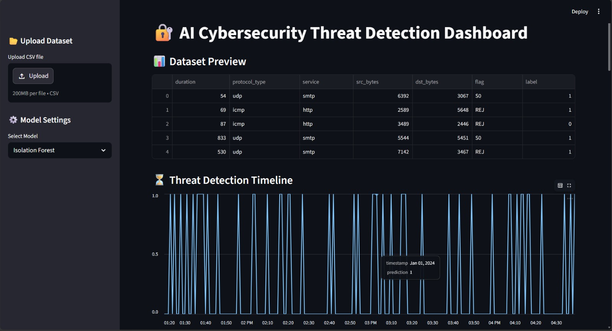
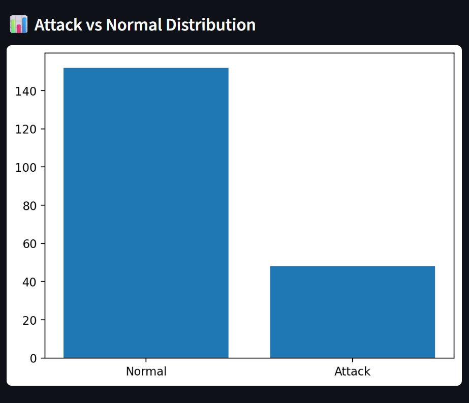
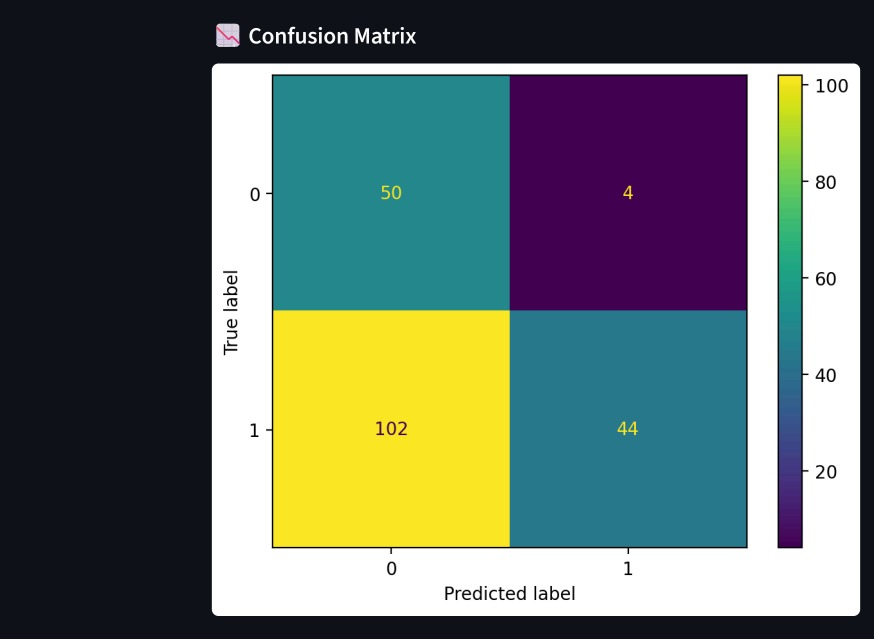
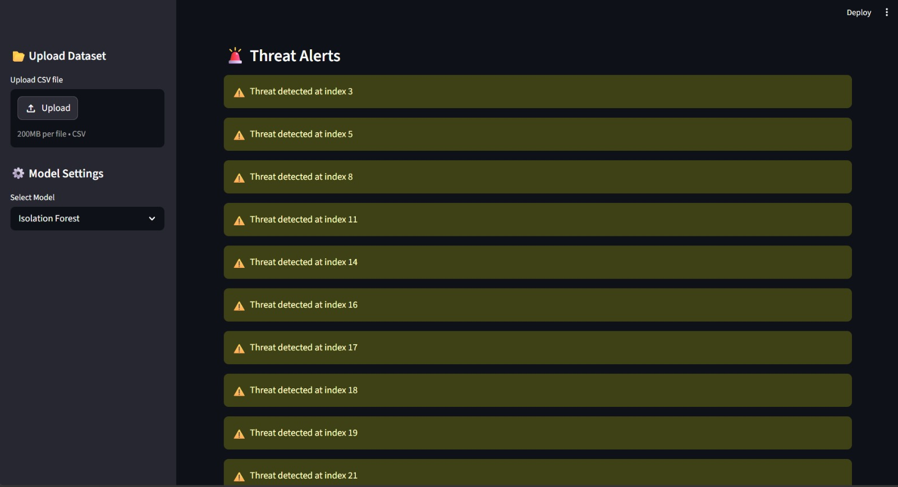
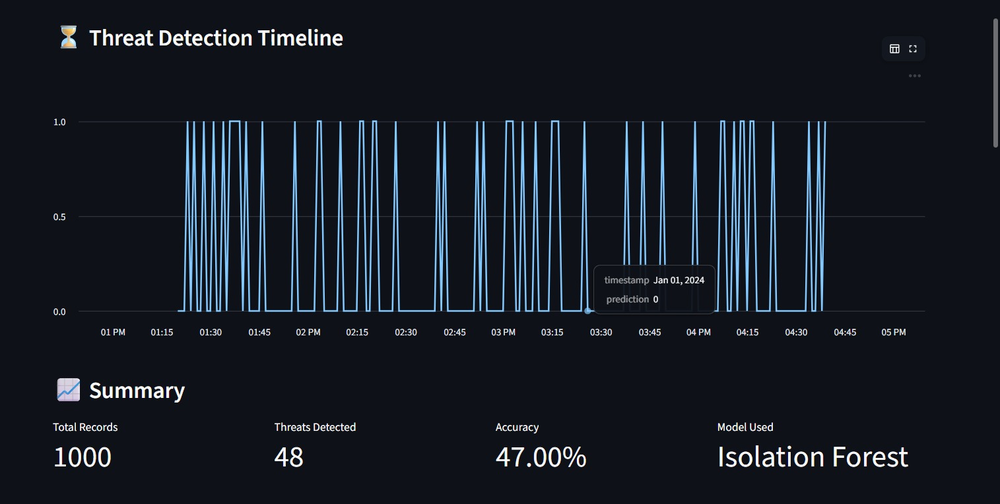
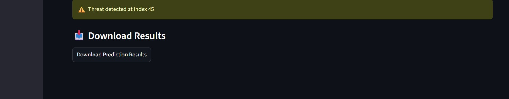

# 🔐 AI-Powered Cybersecurity Threat Detection System

---

## 📌 Overview

This project demonstrates an **AI-powered cybersecurity threat detection system** that analyzes network traffic data and identifies potential cyber threats using machine learning techniques.

The system provides an **interactive dashboard using Streamlit**, where users can upload datasets, train models, visualize results, and detect anomalies in real-time.

---

## 🎯 Problem Statement

Modern systems face increasing cyber threats such as:

- Intrusion attacks
- Unauthorized access
- Anomalous network behavior

Manual monitoring is inefficient and error-prone.  
This project solves the problem by using **AI/ML models to automatically detect threats**.

---

## 🚀 Features

- Machine Learning-based Threat Detection
- Supports Multiple Models:
- Random Forest (Supervised)
- Isolation Forest (Anomaly Detection)
- Upload Custom Dataset (CSV)
- Real-time Dashboard (Streamlit)
- Threat Detection Timeline
- Feature Importance Analysis
- Confusion Matrix Visualization
- Real-time Threat Alerts
- Download Prediction Results

---

## ⚙️ Tech Stack

- **Python**
- **Pandas & NumPy**
- **Scikit-learn**
- **Matplotlib & Seaborn**
- **Streamlit (Dashboard UI)**

---

## 🏗️ Project Structure

```
AI-Powered-Cybersecurity/
│
├── data/ # Dataset files
├── docs/ # Documentation
├── images/ # Screenshots for README
├── models/ # Saved ML models
├── outputs/ # Results / predictions
│
├── src/
│ ├── data_preprocessing.py
│ ├── model.py
│ ├── detect.py
│ └── evaluate.py
│
├── app.py # Streamlit dashboard
├── main.py # Main execution script
├── generate_dataset.py # Dataset generator
├── requirements.txt
└── README.md
```

## ▶️ How to Run

### 1. Clone Repository

```bash
git clone https://github.com/your-username/AI-Cybersecurity-Threat-Detection.git
cd AI-Cybersecurity-Threat-Detection

2. Create Virtual Environment (Optional)
python -m venv venv
venv\Scripts\activate   # Windows

3. Install Requirements
pip install -r requirements.txt

4. Run Streamlit App
streamlit run app.py


🖱️ How to Use
Upload a CSV dataset (or use default dataset)
Select model:
Random Forest
Isolation Forest
System will:
Train model
Detect threats
Show results in dashboard


📊 Output
📌 Dashboard Includes:
Dataset Preview
Summary Metrics
Threat Detection Timeline
Attack vs Normal Graph
Confusion Matrix
Feature Importance (Random Forest)
Threat Alerts


🧠 How It Works
Data Preprocessing
Missing values removed
Categorical data encoded
Model Training
Random Forest / Isolation Forest
Prediction
Classifies normal vs attack traffic
Visualization
Graphs and charts using Matplotlib
Alert System
Displays warnings for detected threats 🚨


📈 Learning Outcomes
•Understanding of Cybersecurity Concepts
•Implementation of Machine Learning Models
•Working with Real-world datasets
•Building Interactive Dashboards
•Data Visualization Techniques
•Model Evaluation (Accuracy, Confusion Matrix)


🌍 Real-World Applications
• Banking Fraud Detection
• Network Intrusion Detection Systems (IDS)
• Enterprise Security Monitoring
•Cloud Security Systems
• AI-driven Security Automation


🔮 Future Improvements
•Real-time network packet monitoring
•Integration with live APIs
•Deep learning-based detection (LSTM)
•User authentication system
•Advanced dashboard UI

---

📸 Screenshots


```

## 

### Attack vs Normal



---

### Confusion Matrix

## 

### Threat Alerts



---

### Threat Timeline



---

### Download Result


